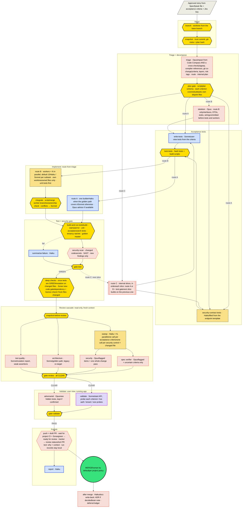
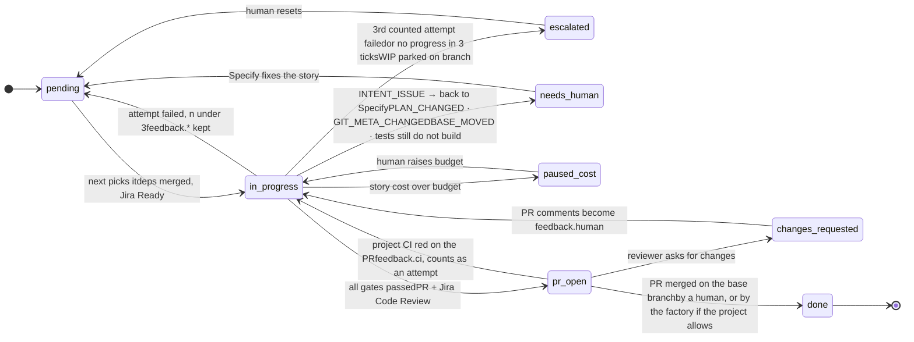
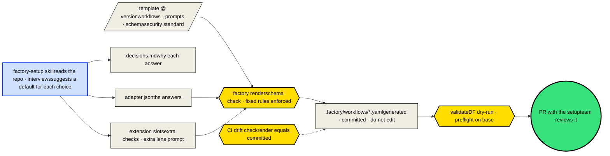
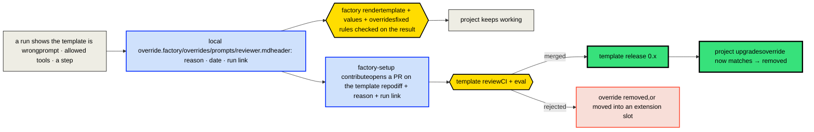

Digital Factory · Delivery workflow · for team discussion

# Feature Delivery Workflow

How one approved story becomes a reviewed pull request, built by agents and governed by deterministic gates and, by default, a human merge. The page explains how we got here, how the process works, what is fixed and what is flexible, and how we plan to build and test it.

1. [1How we got here](#journey)
2. [2The process](#process)
3. [3Fixed and flexible](#rules)
4. [4How we build it](#build)

1

## How we got here

Fourteen decisions, in the order they were made. Each one shows the question, the decision, the reasoning and what was rejected. Green markers are decisions you set; gold ones came from findings or research.

1. 01Four earlier attempts, one picture findinglearning-image devloop, migration-tool devloop, idea-to-app, the AI-delivery proposal decks, an existing project's agent routine

   Question

   Which of the existing approaches is the right one?

   Decision

   None alone. They are layers of one system: a project adapter, a Specify workflow, a Delivery workflow, and a thin driver.

   Why

   Each solved a different part. The learning-image devloop teaches the phases. Migration-tool has the hardest runtime rules (typed state CLI, "environment failure is not a story failure", a human gate). idea-to-app does onboarding. The proposal defines the team and the checks. A real project's agent setup already has the project layer (docs brain, golden paths, task routine).

   Rejected

   Taking one approach whole and adding to it.
2. 02Who drives the loop findingClaude /loop tick vs Digital Factory workflow vs Agent SDK script

   Question

   Should a model decide the next phase each tick, or should deterministic code?

   Decision

   Digital Factory workflows, run by a thin deterministic driver.

   Why

   Gates in DF can't be talked past. Each agent runs in its own context, with its own model and tool limits. DF records every run, which the customer proposal promises. A /loop tick re-reads a 300+ line driver on every tick, and its review runs in the same context as the build.

   Rejected

   Claude /loop tick as the outer loop. An Agent SDK script is kept as a fallback if DF can't do something.
3. 03Ground rules your callSet by you

   Question

   How autonomous, which tracker, which runtime?

   Decision

   One story at a time with your PR review. Jira plus repo task files now, Jira only later. Claude only.

   Why

   Tune the reviewers before adding parallelism. Acceptance criteria stay versioned with the code. One runtime whose deny rules are actually enforced.

   Rejected

   Parallel waves from the start; Copilot as a second runtime.
4. 04Challenge with industry practice researchDark factory, DORA, Team Topologies, recent multi-agent work

   Question

   What would make this better than "agents write code, a human reviews"?

   Decision

   Take the dark factory's verification ideas, not its autonomy: tests the builder can't see or change, no evidence = no finding, small batches, every escalation becomes a rule, measure everything.

   Why

   A full dark factory (no human review) is wrong for customer code under ISO 27001. Its verification mechanisms are what make code trustworthy. DORA: AI amplifies the system it lands in, so small batches and fast feedback matter more, not less.

   Rejected

   Level-5 autonomy with no human review.
5. 05The quality bar your callSet by you

   Question

   How strict should verification be?

   Decision

   Independent review from several angles, user-view tests (integration and unit for the backend), top-level security.

   Why

   This is code the team will build on for years. The cheapest place to catch a defect is before the PR.
6. 06Peter's sdlc-workflow findingFound in itera/sdlc-workflow + workflow-dashboard

   Question

   Build Delivery from scratch, or on something existing?

   Decision

   Use Peter's loop as the skeleton and change it: a PR in place of the local merge, review lenses, a security gate, the Claude runtime.

   Why

   It already has the hard parts: acceptance tests written first and locked by hash, a deterministic test gate with typed verdicts, gate scripts run from the base branch with tamper snapshots, a state machine with retries, and a dashboard.

   Rejected

   A new engine.
7. 07Security: one standard, applied to the change your callShaped by an earlier Itera security assessment (81 security + 56 release findings) and your correction

   Question

   How do we make sure a story never adds a security problem?

   Decision

   One Itera security standard for every project. Delivery checks only new and changed code and its blast radius, and a story may add zero new findings. Whole-project assessment stays an independent workflow; new classes it finds are added to the shared standard.

   Why

   The assessment found things nobody expected, so security can't be just a checklist of known items. Per-story checks must stay focused and fast. Customers should get the same bar on every project.

   Rejected

   Per-project security baselines; scanning the whole codebase inside each story.
8. 08The LPC devloop, run in Podman findinglearning-platform-copilot image

   Question

   What does the onboarding devloop do better or worse?

   Decision

   Take its config schema (as the adapter), cost snapshot with a pause, deferral ledger and stall detection. Leave the rest.

   Why

   Its planning workflows are good (they belong in Specify). Its delivery part runs build, review and live test in one agent, gates on lint OR tests, merges to main by itself, and writes acceptance criteria after the merge.

   Rejected

   An LLM-driven phase loop; single-agent build and review.
9. 09Small models researchOnline research: small-agent teams, the advisor pattern, judge panels

   Question

   Can many small models do more for less than one Opus?

   Decision

   Sometimes. Opus plans and verifies, Sonnet builds the hard parts, Haiku builds mechanical parts and sweeps. Proven on a seeded-defect set before it becomes the default.

   Why

   Small-agent teams match larger models when a strong planner splits the work: "planner-limited, not executor-limited". Cheap panels of weak models lose. Fan-out multiplies tokens unless each call is narrow.

   Rejected

   Replacing Opus with a swarm everywhere.
10. 10Specify splits by function, Delivery by technique your callSet by you

    Question

    How much detail does Specify give, and who splits work for small models?

    Decision

    Delivery starts with an Opus triage that routes the story: A one builder, B a skeleton plus up to N parallel workers (default 10), C ordered slices. Splitting is internal: the caller sees one story and one PR.

    Why

    Specify's functional split isn't fine enough for small models. Hiding the split keeps Jira, the driver and the reviewer simple.

    Rejected

    Child stories with their own PRs and Jira sub-tasks.
11. 11Code Compass, trusted but checked your callSet by you

    Question

    Can the workflow rely on Code Compass?

    Decision

    Not alone. Every impact prediction is cross-checked (ripgrep, compiler references, git co-change), and both are measured against what actually changed.

    Why

    There are doubts about its reliability. The metrics answer the question with data after two waves.

    Rejected

    Blocking work when Code Compass is down (as migration-tool did).
12. 12Deterministic checks findingBuild, tests, linters, mutation, Sonar, dependencies

    Question

    Where do the project's own checks run?

    Decision

    In a check registry in the adapter, staged by cost: test gate every attempt, deep checks once green, then a draft PR where the project's CI decides.

    Why

    Fast checks first, slow ones only when worth it. Only new issues block (thanks to a baseline snapshot). The project CI is the authority, so the factory mirrors it rather than replacing it.
13. 13Tracker states per project your callSet by you

    Question

    Jira workflows differ between projects.

    Decision

    A tracker mapping in each adapter, with English defaults, and a list of statuses the factory must never set.

    Why

    The loop knows only its own states. Each project translates them.

    Rejected

    Hard-coded statuses; local-language defaults.
14. 14The PR is for humans; the tooling stays out of sight your callSet by you

    Question

    What goes into the PR, and who may see that AI built it?

    Decision

    A short PR with the why, the context and the review focus. Run details stay in local Digital Factory records. Disclosure of AI and tooling is a project setting, hidden by default.

    Why

    Reviewers need what the diff can't tell them, not a restatement of it. Some customers must not see the tooling.

    Rejected

    An evidence pack in every PR; AI attribution in commits by default.

2

## The process

The workflow itself: flow, triage, code intelligence, checks, state machine, then reference material you can unfold.

## 2.1 · The workflow: one attempt at one story

This is Peter's `sdlc.yaml`, with stages as the dashboard shows them. The story from Specify isn't treated as final. **Triage** scores its technical complexity and picks a route: **A** one builder, **B** a skeleton plus parallel small-model workers, or **C** sequential slices inside the same run. **Any split stays inside the workflow.** The driver, Jira and the reviewer still see one story, one state and one PR. Delivery may **split** the work as it likes, but may not **reinterpret** it. Every acceptance criterion must still be covered unchanged. A story whose criteria are wrong or contradictory ends as `INTENT_ISSUE` and goes back to Specify.



Agent (Peter's) Verifier (Peter's) Command gate (Peter's) New or changed from Peter's loop Small-model swarm (Haiku) Human

## 2.2 · Triage and decomposition

Specify splits the work by function. Triage splits it technically, sized for the cheapest model that can do it well. This step gets Opus, because research on small-model teams found results are set by the planner, not by the workers.

| Signal | Where it comes from | Pushes toward |
| --- | --- | --- |
| Size of the impact | The union of Code Compass `impact_radius` and a cross-check (ripgrep for symbols, compiler references, files changed together in git history). Disagreements are logged (section 2.3). | Many files → B; too much for one build pass → C |
| Layers crossed | Plan: API, application, domain, persistence, migration, frontend | 3 or more layers → B (one subtask per layer behind the skeleton) |
| Acceptance criteria | Task file | Groups of criteria that don't depend on each other → B or C |
| A golden path exists | `docs/golden-paths/` recipe matches the change | Mechanical → Haiku worker |
| Risk tags | Tenancy, auth, calculations, schema, concurrency | That subtask goes to Sonnet with an advisor and is never parallelised with code it touches |

### Route A · one builder

- Small, or tightly connected work where splitting would cost more in coordination than it saves.
- Haiku if a golden path covers it, otherwise Sonnet.

### Route B · skeleton + workers

- Opus commits a **skeleton** first: interfaces, DTOs, stubs and wiring. That fixes every boundary before anyone builds, so parallel workers can't drift apart. The acceptance tests then compile against it and fail for the right reason.
- Each subtask owns a disjoint set of files and has its own worktree. A script rejects edits outside a worker's files.
- The number of parallel workers is set in the adapter (`parallel.small_agents`, default **10**). The same limit applies to the Haiku review sweep. When the adapter is installed, the workflow is generated with that many worker slots, and DF's `max_concurrency` is set to match. A slot without a subtask is skipped with `when:`, so the graph stays static and visible in the dashboard.
- Triage creates only as many subtasks as the code can be split into, without two workers owning the same files. Ten is a ceiling, not a target.
- Workers commit to the story's branch through the integrate step. The caller sees one branch and one PR.

### Route C · internal slices

- Too big for one build pass: the work runs as ordered slices inside the same run (fixed slice slots, like the worker slots). Each slice uses route A or B and must pass the test gate before the next starts.
- Review and validation run once, on the whole story. The PR has one commit per slice, and its "Review focus" points the reviewer to what matters, so a large PR stays reviewable.
- Nothing appears in Jira or the state file except the story itself.

### Model ladder for workers

- A subtask that fails its unit tests twice moves up one model (Haiku → Sonnet → Sonnet with Opus advisor) before the attempt counts against the story.
- Every subtask records its model and how many escalations it needed. That data tells you when Haiku is worth it.

## 2.3 · Code intelligence: Code Compass with a cross-check

There are doubts about how reliable Code Compass is, so nothing relies on it alone. Every step that uses it also runs a cheap deterministic cross-check, and the workflow measures which of the two was right. Over a few waves this answers when Code Compass helps, when it fails, and whether it is worth its cost.

### How it is used

- **Triage and skeleton:** impact = union of Code Compass `impact_radius` / `find_references` and the cross-check: ripgrep for symbol names, compiler references (Roslyn / `tsc`), and files changed together in git history.
- **Builders and reviewers** may use Code Compass. Ripgrep and file reads are always allowed as a fallback.
- **Code Compass down or its index stale:** continue with the cross-check only, record it, and never block the story or use up an attempt.

### What is recorded (no extra agent calls)

- **After each story, by script:** the impact each source predicted (Code Compass, cross-check, union) compared with the files actually changed and the build errors seen. This gives recall and precision for each source.
- **Misses:** files a worker or a gate had to touch that only one source predicted, or neither did.
- **Failures:** tool errors, timeouts, a stale index, empty answers for symbols that exist.
- **Usage:** Code Compass calls compared with grep and file-read calls per agent, and tokens per step. Did it replace reading files, or add to it?
- Stored as one line per story in `code-intel.jsonl`, a dashboard column, and the local run record.

- **Decision rule after 2 waves:** if Code Compass's recall isn't clearly above the cross-check's, or its misses cause rework, make it optional in the adapter (`code_intel.primary`). If it clearly wins, the cross-check can drop to a sample run on every fifth story.

## 2.4 · Deterministic checks: build, tests, linters, mutation, Sonar, dependencies

Checks are a **registry in the project adapter**, not steps written into the workflow. Each check declares its stage, scope, whether it blocks, and who fixes a failure. The workflow runs them at the cheapest point that still gives useful feedback. No check uses model tokens. Only a trimmed failure summary (Haiku) goes back to an agent, never raw logs.

| Stage | Checks | Why there |
| --- | --- | --- |
| Preflight (base branch) | Build + tests green on the base branch (cached by commit); tools reachable; **baseline snapshot** of linter, Sonar and dependency findings | A red base branch isn't the story's fault. The baseline lets later gates block only on **new** issues, so legacy debt never stalls a story. |
| Red gate | Compile + run the locked acceptance tests: they must fail | Proves the tests test something. |
| Inside the builder (advisory) | Incremental build, unit tests of the touched project, formatter, linter on changed files | Fast feedback inside the agent's loop. Not trusted, because the gate re-runs everything. |
| Test gate (every attempt) | Format check → auto-fix → linters → build (warnings as errors) → unit → integration + acceptance → arch tests, ratchets, golden master → coverage of changed lines | Authoritative, and ordered so it fails fast. Cheap enough to run on every attempt. |
| Security scan (every attempt) | Secret scan and SAST on the change, compared with the base branch by fingerprint | Fast. Only findings the story introduced block (section 2.7). |
| Deep checks (once GREEN) | Mutation testing on changed files (Stryker.NET / StrykerJS incremental); Sonar branch analysis against the new-code quality gate; dependency vulnerabilities and licences (only if lock files changed) | Slow, so there's no point running them before the tests pass. Their output feeds the reviewers: mutation → test-quality lens; Sonar and SAST → security and architecture lenses. |
| Validate | App starts, health probe, migrations on a fresh database, optional DAST baseline (ZAP) | Checks that need the running system. |
| Publish | Push as a **draft PR** → the project's own CI and Sonar PR analysis run → green: mark ready for review and assign the human; red: back to the builder | Project CI is the authority for merging. The factory's gates mirror it to avoid wasting human review time, but never replace it. |
| Per wave / nightly | Full mutation run, full Sonar, full dependency and licence audit, DAST, performance tests | Too slow per story; the results feed the backlog. The whole-project security assessment is a separate workflow (section 2.7). |

### Who fixes a failure

- **Format, auto-fixable lint:** the fix command (`dotnet format`, `eslint --fix`) runs first, with no model.
- **Build, unit, integration, arch:** builder (counts as an attempt).
- **Acceptance tests don't build:** test author (free retry, as in Peter's loop).
- **Surviving mutants, Sonar issues, SAST hits:** become findings with evidence (rule id, `path:line`) for the builder.
- **New vulnerable dependency from this story:** builder. One already on the base branch goes to the deferral ledger and doesn't block.
- **Flaky test:** re-run once, record it, never quarantine it automatically.

### Keeping it cheap and consistent

- **Same commands as CI:** the adapter points at the scripts the pipeline already runs, so "green in the factory, red in CI" can't come from drift.
- **Cache by input hash:** on a retry, checks whose inputs haven't changed are skipped. Dependency checks run only when lock files change.
- **Thresholds per check** in the adapter: blocking severity, new-code only or the whole codebase, timeout.
- **Locked config:** the files that define the checks (linter rules, Sonar settings, Stryker config, CI files) are protected like the tests, so an agent can't weaken them.

```
"checks": [
  { "id": "format",    "stage": "test-gate", "run": "dotnet format --verify-no-changes", "fix": "dotnet format", "blocking": true },
  { "id": "build",     "stage": "test-gate", "run": "dotnet build -warnaserror", "owner": "builder" },
  { "id": "unit",      "stage": "test-gate", "run": "dotnet test --filter Category!=Integration" },
  { "id": "integration","stage": "test-gate", "run": "dotnet test --filter Category=Integration", "needs": ["docker"] },
  { "id": "semgrep",   "stage": "security",  "run": "semgrep --config .factory/semgrep --error", "new_only": true },
  { "id": "mutation",  "stage": "deep",      "run": "dotnet stryker --since:origin/main", "threshold": { "score_changed": 70 } },
  { "id": "sonar",     "stage": "deep",      "run": "dotnet sonarscanner ...", "gate": "new-code", "skip_if": "ci_runs_sonar" },
  { "id": "deps",      "stage": "deep",      "run": "dotnet list package --vulnerable --include-transitive",
    "when_changed": ["**/packages.lock.json", "Directory.Packages.props"], "new_only": true },
  { "id": "ci",        "stage": "publish",   "source": "github-checks", "required": true }
]
```

## 2.5 · The state machine: across attempts and stories

This is Peter's `task-state.js` and `orchestrate-tick.sh`. Three states are added: **pr_open** and **changes_requested** put the human merge inside the machine, and **paused_cost** takes the cost guard from the LPC devloop. A failed attempt re-runs the workflow with the verdicts' feedback.



Phases inside `in_progress`: branched → triaged → skeleton (B) → tests_written → implemented (per subtask in B) → integrated → testing → tested → reviewing → reviewed → validating → validated → publishing

- **Kept from Peter:** verdict tokens per role, free retries when only the acceptance tests fail to build, dependents of a `needs_human` story are never picked, WIP parked with sensitive files stashed, and a tick timeout.
- **Live board on every run:** when a run starts, the driver makes sure Peter's dashboard hub is running and opens the run's page in the browser, in the **Lemmings** theme. Pixel characters walk across the stages: a builder on the running task, a blocker on a pending one, an "oh no" explosion on a failure, and the exit door once the story is done. Everyone watching sees live progress at a glance. Where no browser can be opened (a container or a CI agent), the driver prints the link instead.
- **Pipelining without parallelism:** while a PR waits for you, `next` may start a story that doesn't depend on it. Only one story runs at a time, but your review doesn't stall the loop.
- **Cheaper retries:** from attempt 2 on, skip `triage`, `skeleton` and `write-tests` while the lock hash is still valid. Re-run only the failed subtasks and the review lenses that blocked. Security always re-runs if code in its scope changed.
- **The tracker mirrors the state through the project adapter.** The loop knows only its own states. Each project's adapter maps them to its own Jira workflow: transition names (or ids), per issue type when stories and subtasks differ, and which states only add a comment and a label. The factory ships English defaults (in_progress → "In Progress", pr_open → "In Review", the rest comment and label), and a project overrides only the entries that differ from them. A state with no mapping does nothing in Jira, and a project with no tracker leaves the block out. The task file stays the source of the acceptance criteria until you move to Jira only.

## 2.6 · Model strategy: small models where the work is narrow

Show the research and the model per step

### Verdict on "many small models beat one big model"

Partly true. It holds when the task splits into narrow, independent pieces, when the planner or verifier is strong, and when checking is cheap. It doesn't hold if you replace a strong model with a swarm on tightly connected reasoning work. Evidence:

- **The planner matters most.** An 8B orchestrator with small workers matched a 32B single agent. Worker size barely mattered (GAIA 23.0 / 23.0 / 23.6 with 1.7B / 8B / 32B workers); the systems were "planner-limited rather than executor-limited".
- **A strong advisor makes a cheap executor useful.** Anthropic: Sonnet with an Opus advisor gained +2.7 points on SWE-bench Multilingual at 11.9% lower cost. Haiku with an Opus advisor doubled Haiku's BrowseComp score (19.7% → 41.2%), but still trails Sonnet alone by 29% (at 85% lower cost).
- **Panels of small judges work.** A panel of three small models from different families judged better than GPT-4 alone, at more than 7× lower cost. The diversity across families mattered, and going Claude-only weakens that effect.
- **Weak panels don't fix weak models.** In a fusion experiment, a cheap panel cost more and scored lower than Opus alone. Fusion paid off only with strong panel members.
- **Multi-agent isn't cheap by default.** Fan-out multiplies tokens. It pays only when each call has a small, focused context.

So small models pay off only after a strong model has cut the work into narrow pieces. Specify's functional split isn't fine enough for that, so Delivery's triage does the technical split (section 2.2) and the skeleton fixes the boundaries. The rule: **Opus plans and verifies, Sonnet builds the hard parts, Haiku builds the mechanical parts and sweeps.** Haiku finds candidate problems widely and cheaply, and Opus confirms them precisely.

| Step | Model | Why |
| --- | --- | --- |
| triage + skeleton | Opus | Planning sets the ceiling for everything after it, so it gets the best model. One triage call per story, plus the skeleton on route B. |
| write-tests | Sonnet | The criteria and contract are already precise, so this is translation more than design. |
| security-contract tests | Haiku | A template filled with endpoint names and roles. Mechanical, and checked by the red gate. |
| implement / workers | Haiku | Subtasks with a golden path behind a fixed skeleton: DTOs, mapping, endpoint wiring, repository methods, test data. Moves up the ladder after two failures. |
| implement / workers | Sonnet + Opus advisor | Logic and risk-tagged subtasks. The advisor pattern measured cheaper and better than Sonnet alone. If DF's Claude runtime lacks the advisor tool, the Opus skeleton does the same job up front. |
| sweep (review) | Haiku × N | One call per criterion, and one per security control × changed file. Each gets a small context and answers MET / NOT MET / UNSURE with a `path:line`. Runs in parallel and is cheap. |
| spec + security verifiers | Opus | Read only what the sweep flagged, plus one whole-change security pass for problems that span files (authorization flows), which small models miss. |
| architecture, test quality | Sonnet | Architecture tests and the mutation report do the heavy lifting; the model interprets them. |
| validate | Sonnet | Runs probes against the app; the evidence is the output. |
| adversarial | Opus | Inventing attacks is creative reasoning. Small models don't do it well. |
| summarise-failure, report, PR text, Jira, docs write-back | Haiku | Summarising and formatting from structured inputs. |

- **Prove it before relying on it.** Build a seeded-defect set from past security-assessment findings: take known defects (an open endpoint, a missing tenant filter, sign-in that fails open, a swallowed exception, a token in a log), plant them in branches, and run both review setups: Opus lenses only, and the Haiku sweep with Opus verifiers. Compare defects caught, false findings and cost. Switch only if the cascade catches at least as many.
- **Escalate by uncertainty, not by habit.** An UNSURE from the sweep goes to Opus; a MET with evidence doesn't. Measure that rate. If Opus ends up reading most items anyway, the sweep isn't saving anything.

Sources

- [Can Small Agents Collaborate to Beat a Single Large Language Model? (arXiv 2601.11327)](https://arxiv.org/html/2601.11327v2)
- [Anthropic: The advisor strategy](https://claude.com/resources/articles/the-advisor-strategy)
- [Verga et al.: Replacing Judges with Juries (arXiv 2404.18796)](https://arxiv.org/abs/2404.18796v2)
- [fusion: mixture-of-agents gateway experiment](https://github.com/rishbjain1/fusion)
- [The Batch: One agent works, another directs](https://www.deeplearning.ai/the-batch/one-agent-works-another-directs)

## 2.7 · Security: one standard, applied to the change

**Goal: no story ever adds a new security finding, in any project.** Security isn't a per-project setting. Every project is held to one Itera security standard. Within Delivery, the security check looks only at **new and changed code** and what it directly affects, never at the whole codebase. Finding existing problems across a whole project is a separate, independent job: the security-assessment workflow.

### In Delivery: does this change add a finding?

- **Scope = the diff + its blast radius:** changed files, plus callers and callees of changed symbols, routes, auth configuration and dependency changes. A change can open a hole elsewhere, for example by removing an auth attribute used by other routes.
- **Static scan, new findings only:** secret scan and SAST run on the change. Results are compared with the base branch by fingerprint, and only findings the story introduced block.
- **Locked security tests** for every new or changed endpoint, generated from the standard's templates (unauthenticated, wrong tenant or user, oversized and malformed input, failure behaviour).
- **Open-ended security review** (Opus, fresh context): "What can an attacker do after this change that they couldn't before?" A threat-model pass over the diff, not just a checklist. The Haiku sweep checks the standard's items one at a time, and the Opus verifier confirms what it flags.
- **Adversarial tester** attacks the changed endpoints with tests the builder never saw.
- **New vulnerable dependency** introduced by the story blocks it. One already on the base branch goes to the ledger.

### Outside Delivery: what don't we know yet?

- **The security-assessment workflow** runs independently: per wave, before a release, or on request. It looks at the whole project and isn't limited to known classes. That's how an earlier Itera assessment found problems nobody expected.
- **Its results go two ways:** existing findings become backlog items for that project (through Specify, like any work), and **new classes of finding** are added to the shared Itera standard, so every project's Delivery checks for them from then on.
- Delivery never tries to fix pre-existing findings it notices. It records them in the deferral ledger, out of scope.

Show the Itera security standard (v0, seeded from earlier Itera security assessments)

Each class of finding is paired with the cheapest control that catches it in a change. Static rules and locked tests cost no tokens per story; only judgement calls go to the review sweep. The standard is the same for every project. The adapter only says which tools implement it for the project's stack (for example Semgrep rulesets for C# or TypeScript, Roslyn analyzers, ESLint security rules).

*STATIC*analyzer / Semgrep / secret scan, new findings only *TEST*generated test for changed endpoints, locked *REVIEW*sweep item + Opus verifier, on the diff

| Finding class | Control applied to the change |
| --- | --- |
| Secrets in code, config, logs | STATICsecret scan on the diff; no literal keys or connection strings; no tokens in logs REVIEWsecrets come from the vault or managed identity |
| Authentication fails open | TESTno token → 401; expired or forged token → 401, never anonymous; wrong issuer or tenant → 401 REVIEWidentity from a stable subject id; role lookup fails closed |
| Authorization, tenant isolation, IDOR | TESTaccess across tenants or users by direct id → 403 or 404 REVIEWownership check on every id that comes from the caller |
| Accountability | REVIEWadmin and security-relevant actions write an audit event |
| Privacy and retention | STATICno user input, e-mail or token in log templates REVIEWnew stored data has a retention rule; shared links expire; fixtures are synthetic |
| Unbounded cost and availability | TESToversized body → 413 or 400; page size capped STATICoutbound calls have timeouts REVIEWrate limits on expensive endpoints; a deadline for each request |
| Error handling hides failures | STATICno empty catch or silent fallback TESTmalformed input → 400; dependency down → 5xx, never 200 with empty data |
| Injection and unsafe rendering | STATICno string-built queries, `eval` or unsafe deserialization; no raw-HTML sinks; check the scheme of any URL bound into a link |
| AI features (when touched) | REVIEWcontent safety fails closed; third-party text is marked as data; model and prompt version recorded |
| Dependencies and supply chain | STATICno new vulnerable or unlicensed package; lock files present; images and CI actions pinned |

## 2.8 · Project adapter

Show an example adapter

Based on the LPC devloop's `devloop.config.json` and its schema: commands with working directory and timeout, a service probe, ID labels for the backlog, and pluggable checks. Added: the acceptance-test pattern, the scan commands, the tracker mapping, the models, and the cost budget. The `tracker` block maps the loop's states to each project's own Jira workflow. The factory's defaults are English Jira names; a project lists only the entries that differ (here `pr_open` uses "Code Review", not the default "In Review"). `never` lists statuses the factory must not set; by default those after review, since a human merges. The `merge` block sets who merges: `human` (default), `after-approval` (the factory merges once a human approves), or `auto-low-risk` (the factory merges small changes without risk tags on its own, when every check is green). One file per repo. Example for a .NET backend repo, `orders-api` (illustrative values):

```
{
  "project":  { "id": "orders-api" },
  "git":      { "base_branch": "main", "remote": "origin", "branch_prefix": "ORD",
                "worktree_root": "../orders-api-worktrees", "integration": "pull-request" },
  "backlog":  { "source": "task-files",
                "dir": "docs/tasks",
                "labels": { "id": "ID", "depends_on": "Depends on", "jira": "Jira" } },
  "tracker":  { "type": "jira", "project": "ORD",
                "ready_when": { "status_in": ["To Do", "Ready for Development"] },
                "on_state": {
                  "in_progress":       { "transition": "In Progress" },
                  "pr_open":           { "transition": "Code Review", "comment": "pr_link" },
                  "changes_requested": { "comment": "review_summary" },
                  "needs_human":       { "comment": "reason", "label": "needs-clarification" },
                  "escalated":         { "comment": "reason", "label": "blocked" },
                  "paused_cost":       null },
                  "done":              null },
                "issue_types": { "Sub-task": { "on_state": { "pr_open": { "transition": "In Review" } } } },
                "never": ["Done", "Released", "QA"] },
  "merge":    { "mode": "human",
                "_other_modes": "after-approval | auto-low-risk",
                "auto_low_risk": { "max_diff_lines": 150, "exclude_tags": ["auth", "tenancy", "schema", "calculations"],
                                   "require": ["all-gates-green", "ci-green", "no-open-findings"] } },
  "commands": { "build": { "command": "dotnet", "args": ["build", "-warnaserror"], "timeout_sec": 600 },
                "test":  { "command": "dotnet", "args": ["test", "--no-build"], "timeout_sec": 1200 },
                "dev":   { "command": "dotnet", "args": ["run", "--project", "Orders.Api"] } },
  "tests":    { "acceptance_glob": "**/*.AcceptanceTests/**", "locked_also": ["Directory.Build.props", "*.slnx"] },
  "security": { "secrets": "gitleaks protect --staged",
                "sast": "semgrep --config .factory/semgrep/itera-standard/csharp --baseline-commit origin/main --error",
                "deps": "dotnet list package --vulnerable --include-transitive" },
  "quality":  { "service_probe": { "url": "http://localhost:5000/health" }, "max_diff_lines": 400,
                "checklists": { "golden_paths": "docs/golden-paths",
                                "security_standard": "itera-security@1" } },
  "disclosure":{ "mode": "hidden", "commit_author": "team-bot <dev@orders.example>",
                "pr_template": "default", "pr_max_words": 250 },
  "models":   { "triage": "opus", "skeleton": "opus", "build": "sonnet", "build_mechanical": "haiku",
                "ladder": ["haiku", "sonnet", "sonnet+advisor"],
                "sweep": "haiku", "verify": "opus", "chores": "haiku" },
  "parallel": { "small_agents": 10, "sweep_batch": 10 },
  "dashboard":{ "open_browser": true, "theme": "lemmings", "port": 4777 },
  "decompose":{ "route_b_min_layers": 3, "route_c_above_diff_lines": 400,
                "never_parallel_tags": ["tenancy", "auth", "calculation", "schema"],
                "max_slices": 4 },
  "code_intel":{ "primary": "code-compass", "cross_check": ["ripgrep", "compiler", "git-cochange"],
                "on_unavailable": "continue-with-cross-check",
                "metrics_file": ".task-state/metrics/code-intel.jsonl" },
  "budget":   { "max_attempts": 3, "pause_above_usd": 30, "max_stalled_ticks": 3 }
}
```

A frontend repo gets the same file with `npm`, an ESLint security config and Playwright for the user-view tests. A story that touches both repos runs as internal slices, backend first, and produces one PR per repo, linked to each other and to the same tracker issue.

## 2.9 · The pull request: written for the human reviewer

The PR is where people review the work, so its description carries only what the code can't show: **the tracker task, a short functional description, the why, and the background**. It doesn't restate what the diff already shows (which tests were added, how something was implemented). It stays short: a reviewer should read it in a minute.

### PR description template

```
Title: ORD-123: Customers can cancel an unpaid order

Issue: ORD-123 (link to the tracker task)

## What it does
Short functional description: what a user or caller
can do now, in 1–3 sentences. No implementation details.

## Why
The problem or need behind it, in one or two sentences.

## Context
What a reviewer can't see in the diff: constraints,
assumptions, decisions taken and alternatives dropped.

## Review focus
Where to look closely, and why (at most 3 points).

## Not in this change
Known gaps or follow-ups, if any.
```

- Aim for about 150 words; the template enforces a hard limit (default 250).
- The tracker key goes in the title and at the top, following the project's convention (set in the adapter), so the PR and the task link both ways.
- Sections with nothing to say are left out, except the issue, "What it does" and "Why", which are always present.
- "How it was verified" is one line at most. The project CI checks on the PR show the rest.

### Where everything else goes

- **Run records stay local,** in Digital Factory's output folder and the state directory, which are never committed or pushed: route and subtasks, models used, verdicts, review findings, gate output, cost, Code Compass metrics, deferrals.
- The dashboard and the metrics read them from there. The factory owners use them; the customer's reviewers never need them.
- Review findings that were fixed don't appear in the PR. A finding that was accepted rather than fixed goes into "Not in this change", in plain words.

| Disclosure setting (`disclosure.mode`) | PR, commits, branch names, tracker |
| --- | --- |
| **hidden** (default) | No mention of AI, models, Digital Factory or Code Compass anywhere visible to the customer. Commits use the project's configured author identity, without AI co-author trailers. Branch names follow the project's own convention. Tracker comments and labels are written in neutral team language (for example "blocked: needs clarification"). |
| summary | One line in the PR saying it was prepared with Itera's delivery tooling. Everything else as in hidden. |
| full | A collapsed "How this was built" section in the PR: route, models, review verdicts, cost. For internal projects and for customers who want the transparency. |

- **Hidden applies to artifacts, not to the agreement.** Whether AI tools may work on a customer's code is settled in the contract before any work starts (question 1 of the fit check). The disclosure setting only controls what appears in the customer's repos and tracker.

## 2.10 · Origins: what comes from where

Show what came from each source

| Source | Taken | Left behind |
| --- | --- | --- |
| Peter · `sdlc-workflow` + dashboard | The workflow skeleton, locked tests, deterministic test gate, trust snapshots, state machine, retries by re-run, validator, dashboard | Local merge to main; one generic reviewer; Copilot runtime |
| LPC devloop (learning-platform image) | Config schema as the adapter; the complexity gate, reworked to route to small-model workers and slices rather than a design swarm; cost snapshot and pause threshold; deferral ledger; stall detection; context write-back after merge | An LLM deciding the next phase; build, review and live test in one agent; lint-or-tests gate; autonomous merge; criteria written after the merge. Its planning workflows move to Specify. |
| migration-tool devloop | "Environment failure is not a story failure", the `deferred` verdict, out-of-scope is binding | Inline review in the same session; blocking implementation when Code Compass is degraded |
| ai-delivery-proposal | Several independent review angles, tests first, findings need evidence, human at the edges | One reviewer per angle on every story at Opus price (replaced by the cascade) |
| Earlier Itera security assessments | Finding classes for the shared Itera security standard; the seeded-defect set; an independent assessment workflow outside Delivery | Whole-project scanning inside Delivery; per-project security baselines |

### What going Claude-only costs

- Peter uses GPT models for the test author and the reviewer to get a different model family. Small-judge panels work partly because of that diversity.
- Mitigation: Opus verifies Sonnet's and Haiku's work; each verifier runs in a fresh context with its own lens; locked tests and static rules don't depend on any model.

### What going Claude-only gains

- Under Copilot's bypass mode, tool denies are ignored (Peter's comment in `sdlc.yaml`). Claude Code applies deny rules even in bypass mode, so "the builder can't touch tests" becomes enforced, not just detected afterwards. Check this on the DF Claude runtime.
- Keep the snapshot guards anyway, as a second layer.

3

## What is fixed and what is flexible

Fixed rules are the factory's guarantees. Changing one needs an ADR and two reviewers. Everything else is a setting: per project, per story, or left open until the metrics decide.

FIXED

### Nothing merges past a red check, and every merge is recorded

**Why:** Whoever merges, human or factory, the gates and the project CI must be green, and the run record says who merged and under which policy.

PER PROJECT

### Who merges, and how far the factory moves tickets

Default: a human reviews and merges, and the factory stops the ticket at review. A project can opt in to the factory merging after a human approves, or merging low-risk changes on its own, and to moving tickets further (for example to Done).

**Why:** Accountability stays with a named person by default. Some teams and internal projects trust the gates enough to skip a manual step for routine changes.

FIXED

### Acceptance tests come first and are locked

**Why:** Otherwise an agent can make tests pass by weakening them. The builder can't edit tests, check configs or CI files.

FIXED

### Deterministic gates decide; model verdicts only advise

**Why:** A script gives the same answer every time and can't be talked round.

FIXED

### Verifiers are separate, fresh, read-only

**Why:** A model reviewing its own work shares its blind spots.

FIXED

### No evidence, no finding

**Why:** Model reviewers are noisy. A failing test or a file:line keeps the fix loop short and focused.

FIXED

### Split the work, never reinterpret it; splits stay internal

**Why:** Specify and its human review own the meaning. Callers see one story, one state and one PR.

FIXED

### An environment failure is not a story failure

**Why:** A broken network or tool shouldn't use up a story's attempts.

FIXED

### Every run leaves a record

**Why:** Run records, cost and metrics, kept locally in Digital Factory's output: needed for trust, and for every data-driven decision below.

FIXED

### One security standard for every project; a story may add zero new findings

**Why:** Customers get the same security bar everywhere. Delivery checks only the change, so it never stalls on existing debt. Finding that debt is the independent assessment's job.

FIXED

### One state machine and one set of verdicts for every project

**Why:** So the driver, dashboard and metrics work everywhere without changes.

PER PROJECT

### Commands and the check registry

Build, test, lint, mutation, Sonar, dependencies; thresholds; new-code only or all.

**Why:** Every stack builds and tests differently.

PER PROJECT

### Tracker mapping

Status names, per issue type, statuses the factory must never set.

**Why:** Every Jira workflow is different.

PER PROJECT

### Disclosure: hidden by default

Whether AI, Digital Factory and Code Compass appear in PRs, commits and the tracker: hidden, summary or full.

**Why:** Some customers must not see the tooling. Run records stay local in every mode.

PER PROJECT

### Branching and PR policy

**Why:** Base branch, worktrees, one PR per repo.

PER PROJECT

### Domain quality guards

For example golden masters for calculations. Security is not here: it is one standard (fixed).

**Why:** Domain risks and the project's own history.

PER PROJECT

### Models, parallel agents, budget

Default 10 parallel small agents; cost pause threshold; model per step.

**Why:** Cost and speed trade-offs differ per customer.

PER STORY

### Route A, B or C

**Why:** Triage picks the cheapest way to build this story well.

PER STORY

### Number of workers and slices

**Why:** Only as many as the code can be split into without two workers owning the same files. 10 is a ceiling.

PER STORY

### Model per subtask

**Why:** Haiku for mechanical work, Sonnet for logic; the ladder moves a subtask up after two failures.

PER STORY

### What re-runs on a retry

**Why:** Only failed subtasks and the review lenses that blocked: cheaper retries.

DECIDED BY DATA

### Haiku sweep in place of Opus lenses

**Why:** Switch only if it catches as many seeded defects at lower cost.

DECIDED BY DATA

### Code Compass: primary or optional

**Why:** Decided after two waves of recall and precision metrics.

DECIDED BY DATA

### Mutation score threshold

**Why:** Start lenient, tighten as the numbers show what's achievable.

DECIDED BY DATA

### Whether Haiku builds at all

**Why:** Model ladder statistics show where Haiku succeeds first time.

4

## How we build it

A workflow repository, reviewed like any product. Built in increments, each usable on real stories and each with a measurable exit.

## 4.1 · The workflow repository

```
itera/delivery-factory          (fork of sdlc-workflow)
├─ workflows/      prepare · build · verify · publish
│                  templates; worker slots generated from
│                  the adapter's parallel.small_agents
├─ cli/            TypeScript control plane: state machine,
│                  adapter schema, gates, tracker, metrics
├─ agents/         one file per role: model, tools, prompt
├─ prompts/        one per role, versioned
├─ security/       Itera security standard (versioned):
│                  catalog, Semgrep rules per stack, test templates
├─ schemas/        adapter.schema.json
├─ dashboard/      Peter's workflow-dashboard, extended;
│                  opens on each run, Lemmings theme
├─ evals/          fixture repo, reference stories,
│                  seeded-defect branches, scorer
├─ tests/          unit + workflow contract (fake agents)
├─ skill/          factory-setup skill, packaged with the
│                  template snapshot at every release
└─ docs/adr/       every change to a fixed rule
```

### How changes get reviewed

- **Code:** a PR with unit and contract tests green in CI.
- **Prompts or model routing:** a PR plus an eval report. No regression on the seeded-defect set or the reference stories beyond the agreed tolerance.
- **Fixed rules (chapter 3):** an ADR plus two reviewers from the factory owners.
- **Releases:** semantic versions; each project pins a version in its adapter, so an update never surprises a running project.
- **Dogfooding:** from increment 1, the factory builds its own features through its own loop, with human review. Gates, check configs and verifier prompts stay protected paths.

## 4.2 · The project setup skill

A tech lead adopts the factory through one skill, `factory-setup`, from the first pilot on. Its questions cover exactly the "per project" items of chapter 3. It reads the project, interviews the tech lead with a suggestion for every choice, and produces the project's customized workflow. The key design question is how the ideal workflow travels inside the skill.

### Our approach: template + values + named extension points

The ideal workflow is a versioned template. Each project supplies values (the adapter) and fills a few declared extension points. `factory render` generates the project's workflow from those, and nobody edits the generated files. Anything that doesn't fit a value or a slot is a change to the template itself, which benefits every project.

| Option for the baked-in template | How it works | Verdict |
| --- | --- | --- |
| Copy and edit | The skill copies the full workflow (YAML, prompts, scripts) into the project and edits it in place. This is how Peter's `.intent-loop/` works today. | Easy to start, but each project drifts into a fork. Upgrades become manual merges, and nothing stops an edit that removes a fixed rule. |
| **Template + values, rendered** | The ideal workflow is a **versioned template**. The skill writes only **values** (the adapter). A render step generates the project's workflow files from template@version + values. Like a Helm chart with values, or Copier with its answers file. | **Part of our approach.** The customized copy is reproducible, upgrades re-render with the saved answers, and fixed rules simply aren't parameters, so they can't be changed. |
| **Template + named extension points** ← **our approach** | Template + values, plus a few declared slots for what values can't express: extra checks, an extra review lens prompt, project hooks before publish. Each slot is validated by the schema. | **Chosen.** Values cover most customization; the slots cover the rest without forking. Anything that doesn't fit a slot becomes a change request to the template, which improves it for every project. |



### The interview

- **Detect first, ask second.** Read build files, the CI pipeline, test projects, linter and Sonar config, branch names and commit keys, then propose answers. Ask only where detection is unsure.
- **1 · Repos and branching:** base branch, worktrees, one PR per repo.
- **2 · Checks:** derived from the CI pipeline so factory and CI run the same commands; thresholds; mutation tool; does Sonar run in CI?
- **3 · Tracker:** read the Jira workflow through the connector, propose the state mapping with English defaults, set the statuses the factory must never use.
- **4 · Tests:** acceptance-test pattern, integration infrastructure (containers, test database), fixture data rules.
- **5 · Models, parallelism, budget:** defaults (10 parallel small agents) with the reasons, changed only on request.
- **6 · Code intelligence:** is Code Compass available; the cross-check is always on.
- **7 · Domain quality guards:** golden masters, invariants specific to the product.
- **8 · Security:** pin the standard's version and map it to the stack's tools. The rules themselves aren't asked about.
- At most 4 questions per round, recommended option first, each with a one-line reason.

### What the skill does and doesn't touch

- **Asks only about chapter 3's "per project" items.** Fixed rules are shown up front as non-negotiable, with their reasons. "Decided by data" items show the current default and how it will be decided.
- **Never edits the generated YAML.** A wish the values can't express is written up as a change request to the template repo.
- **Validates before handing over:** schema, render, a DF dry run of every workflow, and a preflight that build and tests are green on the base branch.
- **The setup is itself a PR,** with `decisions.md` explaining every answer, so the team reviews the customization like code.
- **Modes:** `init` · `explain` (walks through the current setup) · `change` (one area) · `upgrade` (new template version: re-renders with the saved answers, asks only about new parameters, shows the diff) · `contribute` (turns a local override into a PR on the template repo, section 4.3).

- **One source of truth.** The template lives in the workflow repository. The skill is **packaged from it at each release**: SKILL.md, the template snapshot, the schema and the render script, all with the same version. Nobody maintains a second copy by hand, and the skill's questions always match the template's parameters.

## 4.3 · Fixing the template: a local change, then a PR to the template repo

The parameters are known from the start: they are the "per project" items in chapter 3, so the adapter schema and the setup skill are used from the first pilot. What we can't know yet is where the **template itself** is wrong: a prompt that misleads, a tool missing from a role's allowed list, a step in the wrong place. Fixing that must be easy and must never block a project, so the path is **a local change now, and a PR to the template repo**.



### How a local override works

- **A whole template file, edited as text,** placed under `.factory/overrides/` with the same path: a prompt, a role file (model, allowed tools), or a workflow. No special syntax; any editor works.
- **A short header** in each override: why, the date, and the run or story that showed the problem.
- **Render applies overrides last,** then checks the fixed rules on the final result: locked tests, read-only verifiers, gates present, nothing merging past a red check. An override that weakens a fixed rule is refused.
- **Always visible:** overrides are listed in the run record and on the dashboard. The CI drift check accepts only declared overrides. One with no upstream PR after a week is flagged.

### From override to template

- **`factory-setup contribute`** turns the override into a PR on the template repo, with the diff, the reason and the run link. No manual copying.
- **The template owners review it** like any template change: CI, and the eval when prompts or tools change.
- **Merged:** the next template release contains the fix. On upgrade, an override that now matches the template is removed automatically. If it differs, the skill shows a three-way diff.
- **Rejected:** the override is removed, or, if it's really project-specific, it moves into a named extension slot.

| Template versions | What they mean |
| --- | --- |
| 0.x, released often during the pilots | Fixes from contributed overrides arrive quickly. The adapter schema may still gain fields; the setup skill's `upgrade` mode asks only about new ones. |
| v1 | A promise of stability: the schema and extension slots won't change incompatibly. Reached when at least 2 pilots on different stacks have run about 20 stories, and no new override has been needed for 2 weeks. |
| After v1 | The same override-and-contribute path stays. It's simply needed less often. |

## 4.4 · Three levels of testing

| Level | What it covers | Model cost | When |
| --- | --- | --- | --- |
| Unit | State transitions (including property tests), adapter schema, tracker mapping, ownership check, metrics maths | none | every commit |
| Workflow contract | Test variants of the workflows where agents are fake scripts acting out cases: a builder that edits a locked test is rejected, a reviewer that changes code is caught, an empty worker slot is skipped | none | every commit |
| Eval | Fixture repo with \~10 reference stories and seeded-defect branches. Scores pass rate, defects caught, false findings, cost and time. | real | nightly, and on any prompt or model change |

## 4.5 · Increments

Each increment is usable on real stories. **One workflow first, four from increment 2:** increment 0 keeps Peter's single workflow, already grouped into the four stages, with each stage's inputs and outputs explicit in the state file. The split happens once the typed control plane (increment 1) can hold the trust snapshots outside agents' reach, because today they live safely in the engine's memory and must not become files an agent could edit. Everything from increment 2 on sits behind an adapter flag, so a feature that doesn't pay for itself can be switched off. Select an increment:

### Increment 0 · Fork and run

- Fork `sdlc-workflow`, switch to the Claude runtime
- Draft PR instead of local merge
- Each run opens the live dashboard in the browser (Lemmings theme)
- Adapter v0: commands, git, tracker; `factory render` with local overrides from the first day, so no project ever holds a hand-edited copy
- Run on the fixture repo and one real story from a pilot project

### Done when

- 3 real stories reach a PR
- You would merge at least 2 without rework

### Increment 1 · Typed control plane

- Move the bash and JS control logic into one TypeScript CLI
- Tests that check it behaves exactly like Peter's scripts
- Unit and workflow-contract tests in CI

### Done when

- Same results on recorded runs
- No bash beyond thin wrappers

### Increment 2 · Quality bar

- Split into prepare / build / verify / publish workflows
- 4 Opus review lenses, security scan, deep checks
- Check registry and Itera security standard v0

### Done when

- The seeded-defect set is caught at the agreed rate
- No gate ever passes a planted defect

### Increment 3 · Measure

- Cost snapshots, deferral ledger
- `factory-setup` skill: init, explain, change, upgrade and contribute modes
- Code-intel metrics
- Dashboard columns and local run records
- PR template and the disclosure setting

### Done when

- Every run produces a complete metrics row

### Increment 4 · Cheaper review

- Nightly eval harness
- Haiku sweep + Opus verifiers behind a flag

### Done when

- Cascade catches at least as many seeded defects as Opus only, at lower cost: becomes the default

### Increment 5 · Parallel build

- Triage, route B, N workers (default 10)
- Skeleton, ownership check, model ladder

### Done when

- Route B stories pass the gates as often as route A, with lower cost or time

### Increment 6 · Full coverage

- Route C slices
- Adversarial tester
- Per-wave security audit

### Done when

- Adversarial tests find defects the other checks missed, or the step is removed

## 4.6 · How we reach the final solution

**Build**One increment, behind a flag.

**Eval**Nightly run on the fixture repo and seeded defects.

**Real stories**2–3 stories from the pilot project through the loop, with PR review.

**Review the numbers**A weekly session on the metrics: first-pass gate rate, defects caught, escaped defects, your review time, cost per story.

**Decide**An ADR: keep, tune or drop. Then the next increment.

"Final" means the metrics have been stable for two waves and no fixed rule has needed an exception. After that, changes go through the same review as any product release.

## 4.7 · Open questions for the team

- **Fork or contribute upstream?**A separate fork of sdlc-workflow, or PR mode, review lenses and adapters added to Peter's repo behind settings (one tool for everyone)?
- **TypeScript now, compiled later?**Move to Go or Rust when the factory ships as a product like DF? Which language does the DF team prefer?
- **Can DF do this natively?**Retry loops and dynamic fan-out in DF would remove the driver's loop and the slot generation. Calling a sub-workflow with its outputs kept inside the engine would let us split into four workflows from day one without weakening the trust snapshots.
- **Claude runtime in DF:**Are deny rules enforced in bypass mode? Is the advisor tool available?
- **Where does Sonar run?**In project CI only (the factory reads the result), or also locally in the deep-checks stage?
- **Eval fixture:**A small .NET API built for the purpose, or the LPC app?
- **Distributing the setup skill:**Through a Claude Code plugin marketplace for Itera, or as a git repo people link into their skills folder?
- **Budgets:**Cost pause per story, and the agreed catch rate for seeded defects.

Itera · Digital FactoryDelivery workflow · working draft for team discussion · comment on the page to discuss